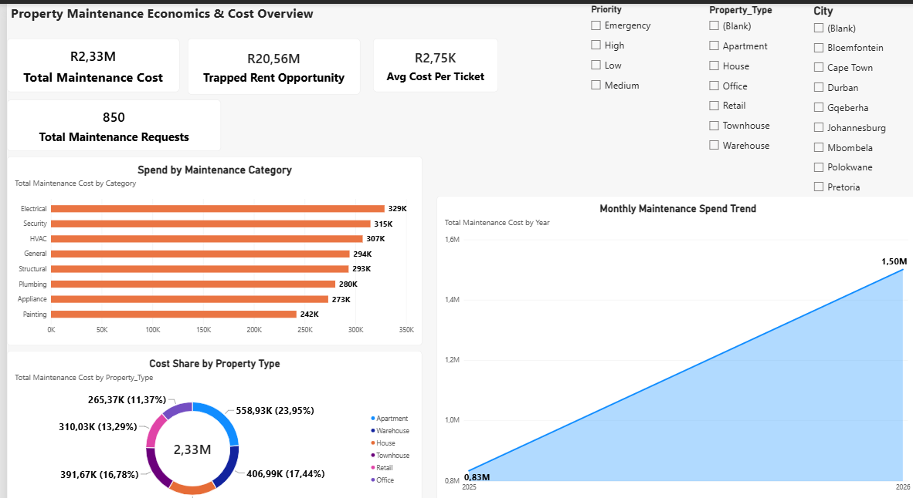
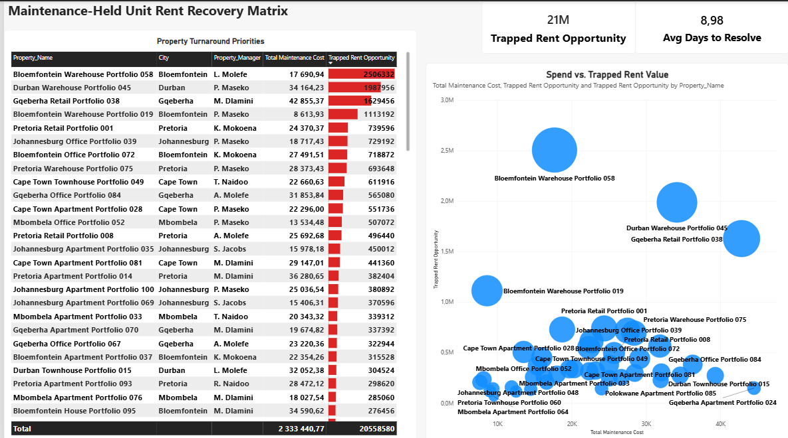
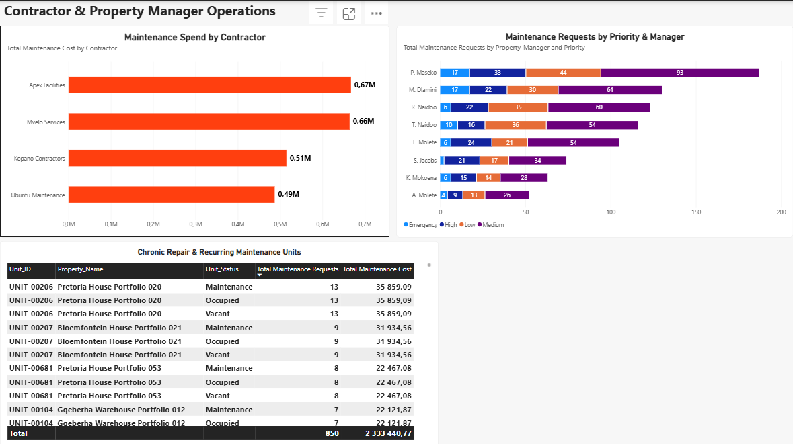

# Commercial Property Maintenance Economics & Rent Loss Recovery

[](https://powerbi.microsoft.com/)
[](https://www.mysql.com/)
[](https://www.microsoft.com/excel)
[](https://learn.microsoft.com/en-us/dax/)

---

## 📌 Executive Summary
In commercial real estate portfolio management, maintenance costs represent only a fraction of total operating exposure. The true financial risk lies in **maintenance-held units**—downtime that locks up rental cash flows.

This project delivers an end-to-end data analytics solution evaluating **R2.33M in maintenance spend** across **100 commercial properties** and **1,308 units**. By modeling maintenance request logs alongside leasing and unit status data, this analytics suite identifies **R20.56M in annual market rent trapped** in units offline for repairs, providing property managers with an actionable turnaround matrix to accelerate unit release and maximize Net Operating Income (NOI).

---

## 🛠️ Data Architecture & Modeling

### 1. Database Schema (MySQL DDL)
The transactional dataset was modeled into a relational star schema structure in MySQL, establishing strict entity integrity across properties, units, categories, and maintenance logs:

```sql
-- 1. Property Dimension
CREATE TABLE dim_property (
    property_id VARCHAR(20) PRIMARY KEY,
    property_name VARCHAR(100) NOT NULL,
    city VARCHAR(50),
    province VARCHAR(50),
    property_type VARCHAR(30),
    property_manager VARCHAR(50),
    total_units INT
);

-- 2. Unit Dimension
CREATE TABLE dim_unit (
    unit_id VARCHAR(20) PRIMARY KEY,
    property_id VARCHAR(20),
    unit_number VARCHAR(10),
    unit_type VARCHAR(30),
    bedrooms INT,
    area_m2 NUMERIC(10,2),
    market_rent NUMERIC(12,2),
    unit_status VARCHAR(20),
    FOREIGN KEY (property_id) REFERENCES dim_property(property_id)
);

-- 3. Maintenance Fact Table
CREATE TABLE fact_maintenance_records (
    record_id INT AUTO_INCREMENT PRIMARY KEY,
    unit_id VARCHAR(20),
    property_id VARCHAR(20),
    category_name VARCHAR(50),
    maintenance_spend DECIMAL(10,2),
    request_date DATE,
    resolution_days INT,
    unit_status_at_request VARCHAR(20),
    FOREIGN KEY (unit_id) REFERENCES dim_unit(unit_id),
    FOREIGN KEY (property_id) REFERENCES dim_property(property_id)
);

## 📊 Power BI Dashboard Architecture & Key Insights

### Page 1: Executive Maintenance Overview


#### 🎯 Focus & Insights
* **Budget Breakdown:** Tracks **R2.33M total maintenance spend** across **850 service requests** with an average ticket cost of **R2,745.22**.
* **Category Share:** Trade categories like **Electrical**, **HVAC**, and **Security** represent the highest expense concentrations across commercial assets.
* **Spend Trajectory:** Analyzes monthly repair expenditure trends to identify seasonal capex surges and support proactive cash flow planning.

---

### Page 2: Rent Recovery & Turnaround Matrix


#### 🎯 Focus & Insights
* **Trapped Rent Identification:** Isolates **64 units currently in maintenance status**, exposing **R20.56M in annual market rent** offline.
* **Turnaround Prioritization Matrix:** Pairs repair cost against locked annual rental value to rank properties by ROI turnaround potential.
* **Capital Efficiency:** Highlights quick-win opportunities where minor maintenance expenditure (e.g., under R30,000) releases over **R2.0M+ in annual rental revenue**.

---

### Page 3: Operational & Manager Performance


#### 🎯 Focus & Insights
* **Contractor SLA Tracking:** Evaluates vendor performance across average turnaround resolution times (**9.0 days portfolio average**).
* **Workload & Priority Distribution:** Maps maintenance requests by property manager and ticket urgency (`High`, `Medium`, `Low`).
* **Chronic Unit Recurrence:** Identifies the top 10 recurring repair units, pinpointing candidates for full asset replacement rather than inefficient piecemeal repairs.

---

## 📐 Key DAX Calculations

```dax
-- Total Maintenance Expenditure
Total Maintenance Cost = SUM(Maintenance[Cost])

-- Total Service Tickets
Total Maintenance Requests = COUNT(Maintenance[Maintenance_ID])

-- Average Ticket Cost
Avg Cost Per Ticket = DIVIDE([Total Maintenance Cost], [Total Maintenance Requests], 0)

-- Average Resolution Duration
Avg Days to Resolve = AVERAGE(Maintenance[Resolution_Days])

-- Trapped Annual Market Rent (Maintenance-Held Units)
Trapped Rent Opportunity = 
CALCULATE(
    SUM(Units[Market_Rent]) * 12,
    Units[Unit_Status] = "Maintenance"
)

-- Rent Recovery ROI Multiple
Rent Recovery Multiple = DIVIDE([Trapped Rent Opportunity], [Total Maintenance Cost], 0)

├── assets/
│   ├── matrix.png
│   ├── overview.png
│   └── performance.png
├── excel/
│   ├── Project 49-Property-Management-Analytics.xlsx
│   └── Project_49_Property_Management_Project_2_0_Phase_4_Maintenance_Economics.xlsx
├── PowerBI/
│   └── Property_Maintenance_Analytics.pbix
├── SQL/
│   ├── schema_ddl.sql
│   └── analytics_queries.sql
└── README.md

💡 Strategic Value & Business Impact
This analytics framework bridges the gap between facility operations and revenue management for commercial property portfolios. By transforming static maintenance records into predictive rent-recovery insights, property group managers can:

Eliminate Revenue Bottlenecks: Systematically identify and prioritize repair jobs that unlock the highest volume of blocked annual market rent.

Optimize Capital Allocation: Shift capital expenditure away from endless reactive repairs on chronic failure units towards targeted, high-ROI unit turnarounds.

Enforce Accountability: Leverage data-driven manager and vendor performance benchmarking to reduce unit vacancy duration and boost portfolio Net Operating Income (NOI).